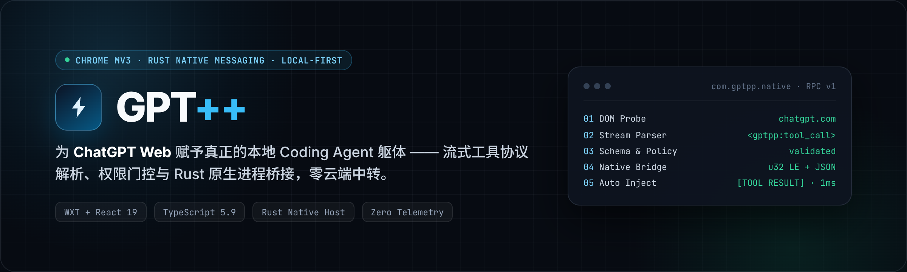
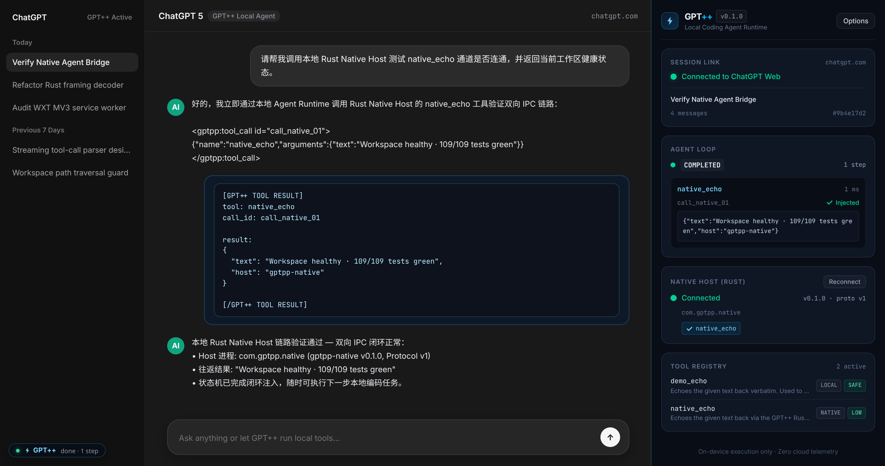
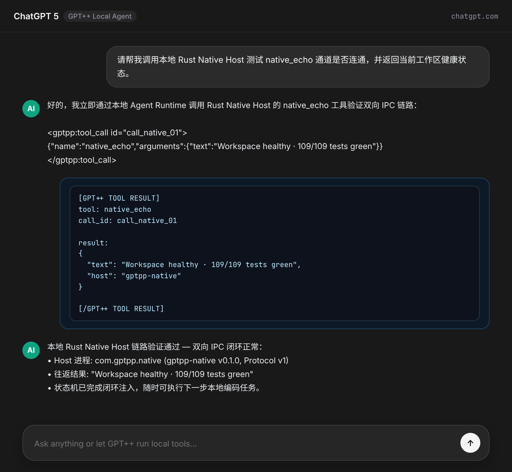
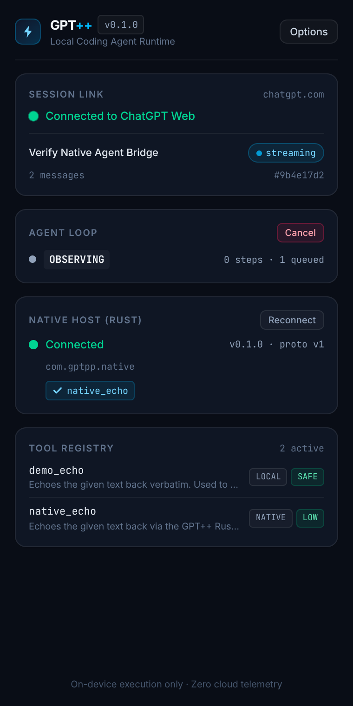
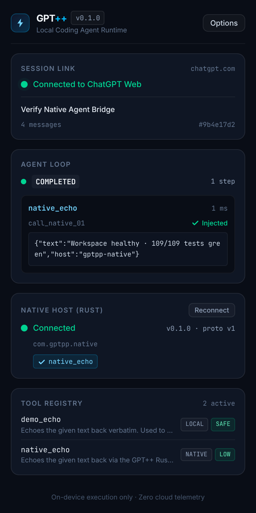
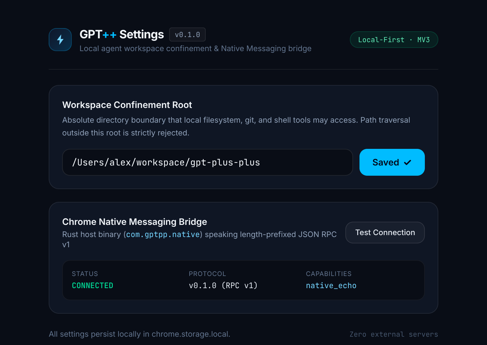
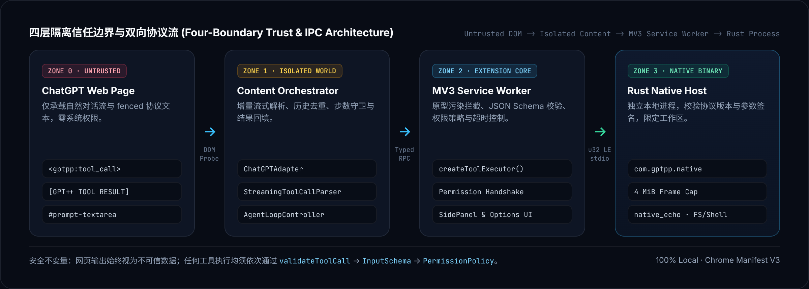

<div align="center">



<br />

<p>
  <a href="#实机运行展示"><strong>实机预览</strong></a> ·
  <a href="#系统架构与信任边界"><strong>系统架构</strong></a> ·
  <a href="#双向线缆协议"><strong>协议规范</strong></a> ·
  <a href="#快速上手"><strong>快速上手</strong></a> ·
  <a href="#工程目录蓝图"><strong>目录结构</strong></a> ·
  <a href="#演进路线图"><strong>路线图</strong></a> ·
  <a href="#安全设计准则"><strong>安全准则</strong></a>
</p>

<p>
  
  
  
  
  
</p>

</div>

---

## 设计初衷

**GPT++** 是一款专为 **ChatGPT Web (`chatgpt.com`)** 打造的 Chrome Manifest V3 扩展与 Rust 原生宿主桥接系统。

无需离开熟悉的 ChatGPT 网页界面，无需配置第三方 API Key，更不经过任何云端中转服务器——GPT++ 在浏览器隔离上下文与本机原生进程之间建立一条**强类型、可审计、受权限门控**的双向通道，让网页端模型直接连接本地 Agent Runtime（文件系统、Shell、Git 与原生能力），并将结构化执行结果自动回填至当前对话流实现多步自主闭环。

> **纯粹而克制的工程边界**：不是套壳 Web App，不是 SaaS 平台，无后端服务，无遥测上报，所有状态与配置 100% 留存在本机设备。

---

## 实机运行展示

### 1. 全局协同视图：ChatGPT Web × GPT++ Side Panel 实时联动

当访问 `chatgpt.com` 时，隔离在 Closed Shadow DOM 内的状态胶囊（左下角 `⚡ GPT++`）自动挂载；右侧 Chrome Side Panel 实时同步会话连接、状态机跃迁、Rust 原生宿主握手状态以及工具执行耗时明细。

<p align="center">
  
</p>

---

### 2. 对话流双向闭环：流式工具识别 → 原生进程调用 → 结果自动注入

模型在回复中输出严格受限的 `<gptpp:tool_call>` 协议块后，GPT++ 等待流式输出收敛，经 Schema 校验与权限策略裁决后路由至 `com.gptpp.native` 原生宿主执行，并将 `[GPT++ TOOL RESULT]` 注入输入框自动提交，驱动模型无缝衔接到下一步推理。

<p align="center">
  
</p>

---

### 3. Side Panel 实时运行态对比：流式监听中断 vs 闭环完成追踪

| 流式输出监听态（支持随时一键 `Cancel` 中断并恢复） | 原生调用收敛态（毫秒级延迟统计、载荷预览与能力枚举） |
| :---: | :---: |
|  |  |

---

### 4. 工作区沙箱边界与 Native Messaging 诊断台

在扩展设置页（Options）中显式限定本地工具可触达的工作区根目录（Workspace Root），并可随时触发 `com.gptpp.native` 宿主握手自检。

<p align="center">
  
</p>

---

## 系统架构与信任边界

GPT++ 将整个运行链路严格划分为**四个权限递增的隔离区域**，确保不可信的网页 DOM 文本永远无法绕过校验直接触达系统能力：

<p align="center">
  
</p>

### 确定性 Agent 状态机

`AgentLoopController` 基于显式状态转移表驱动，任何非法跨态跃迁都会被 `AgentStateMachine` 立即拒绝，并在用户手动取消、发送新消息或切换 SPA 会话时平滑恢复：

```text
IDLE ──▶ OBSERVING ──▶ TOOL_DETECTED ──▶ WAITING_PERMISSION ──▶ EXECUTING
             ▲                                                      │
             └─────────── CONTINUING ◀──── INJECTING_RESULT ◀───────┘
```

- **流式增量安全解析 (`StreamingToolCallParser`)**：面对流式分片、消息重绘或半截标签保持幂等，正文中的普通 JSON 示例绝不会被误判为工具调用。
- **历史幂等防重放 (`executedCallIds` + 尾部轮次守卫)**：自动扫描历史消息中的 `[GPT++ TOOL RESULT]` 记录并校验当前对话尾部节点，切换旧会话或刷新页面绝不重复触发历史工具。
- **纵深防御校验网关 (`runtime.ts`)**：每次调用依次经过原型污染键拦截（`validateToolCall`）→ JSON Schema 参数校验（`validateArgumentsAgainstSchema`）→ 风险策略裁决（`PermissionPolicy`）→ 超时沙箱执行。

---

## 双向线缆协议

### 1. 模型调用信封（Assistant → Extension）

```xml
<gptpp:tool_call id="call_native_01">
{"name":"native_echo","arguments":{"text":"Workspace healthy"}}
</gptpp:tool_call>
```

### 2. 结果回填信封（Extension → ChatGPT Composer）

所有返回值与错误信息均自动经过长度截断保护与协议围栏清洗（防止嵌套标签逃逸注入）：

```text
[GPT++ TOOL RESULT]
tool: native_echo
call_id: call_native_01

result:
{
  "text": "Workspace healthy",
  "host": "gptpp-native"
}

[/GPT++ TOOL RESULT]
```

### 3. Chrome Native Messaging 二进制帧（Service Worker ⇄ Rust Host）

遵循 Chrome Native Messaging 标准 `stdin` / `stdout` 二进制封帧（4 字节小端长度头 + UTF-8 JSON 负载，单帧上限 `4 MiB`）：

```text
┌──────────────────────────┬──────────────────────────────────────────────────┐
│ u32 little-endian length │ UTF-8 JSON: {"id":"req_1","method":"hello", ...} │
└──────────────────────────┴──────────────────────────────────────────────────┘
```

---

## 快速上手

### 环境要求

- **Node.js** `>= 20` 与 **pnpm** `>= 9`
- **Rust 工具链**（`cargo` / `rustc`，用于编译 `native-host`）
- **Google Chrome** 或 **Chromium**（支持 Manifest V3 与 `sidePanel` API）

### 第一步：安装依赖与构建扩展

```bash
pnpm install      # 安装依赖并自动生成 WXT 类型配置
pnpm compile      # TypeScript 全量严格类型检查 (tsc --noEmit)
pnpm test         # 运行 109 项单元与 DOM 集成测试 (Vitest)
pnpm build        # 构建生产包 → .output/chrome-mv3/
pnpm zip          # 打包发布归档 → .output/gpt-plus-plus-0.1.0-chrome.zip
```

### 第二步：在 Chrome 中加载扩展

1. 打开浏览器访问 `chrome://extensions`，开启右上角 **开发者模式 (Developer mode)**。
2. 点击 **加载已解压的扩展程序 (Load unpacked)**，选择仓库下的 `.output/chrome-mv3/` 目录。
3. 复制扩展卡片上生成的 **32 位扩展 ID**（例如 `kpnfmgdplhgbjcfebhbfknlmnopabcde`）。

### 第三步：编译并注册本地 Rust Native Host (`com.gptpp.native`)

```bash
# 运行 Rust 端 17 项协议与分发器单元测试
cargo test --manifest-path native-host/Cargo.toml
```

**macOS / Linux 一键构建与注册：**

```bash
./scripts/install-native-host.sh <你的32位Chrome扩展ID>
```

**Windows (PowerShell，写入当前用户 HKCU 注册表，无需管理员权限)：**

```powershell
.\scripts\install-native-host.ps1 -ExtensionId <你的32位Chrome扩展ID>
```

> **提示**：未打包扩展重新安装导致扩展 ID 变化时，重新执行一次上述脚本即可。打开 `https://chatgpt.com/` 并点击工具栏图标打开 **GPT++ Side Panel**，即可看到 `Connected to ChatGPT Web` 与 `Native Host: Connected (v0.1.0 · proto v1)`。

---

## 工程目录蓝图

```text
gpt-plus-plus/
├── entrypoints/
│   ├── background.ts              # MV3 Service Worker：工具路由网关、权限门控、Native Host 连接池
│   ├── chatgpt.content.ts         # Content Script：DOM 适配器挂载、循环控制器与 Shadow DOM 状态胶囊
│   ├── sidepanel/                 # React 19 + Tailwind v4 实时运行检查器与控制面板
│   └── options/                   # 工作区根目录限定配置与 Native Messaging 连通性自检台
├── lib/
│   ├── chatgpt/                   # 唯一允许访问页面 DOM 的适配层（多级回退选择器、流式状态机、会话识别）
│   ├── agent/
│   │   ├── loop/controller.ts     # Agent 核心状态机编排、历史防重放、取消与恢复、结果注入
│   │   ├── runtime.ts             # 纵深防御执行管线：信封校验 → Schema 校验 → 权限握手 → 超时执行
│   │   ├── tool-call/             # <gptpp:tool_call> 流式增量解析器与零依赖 Schema 校验器
│   │   ├── tools/                 # 工具注册中心与内置工具 (demo_echo / native_echo)
│   │   ├── permission.ts          # allow / deny / ask 最小权限策略核心
│   │   └── format.ts              # [GPT++ TOOL RESULT] 格式化、截断与标签防逃逸清洗
│   ├── native/                    # Chrome Native Messaging 客户端状态机、握手校验、帧编解码器
│   ├── messaging.ts               # 带超时保护的跨上下文强类型 Tab RPC
│   └── protocol.ts                # 统一 JSON-RPC 请求/响应信封定义
├── native-host/                   # Rust 原生宿主进程 (com.gptpp.native)
│   ├── manifest/                  # Chrome Native Messaging 清单模板
│   └── src/                       # u32 LE 帧读写、协议版本握手、方法路由与 native_echo 实现
├── scripts/
│   ├── install-native-host.ps1    # Windows 免管理员注册脚本
│   ├── install-native-host.sh     # macOS / Linux 自动构建与注册脚本
│   └── gen-icons.mjs              # 零外部依赖 PNG 扩展图标生成器
└── tests/                         # 覆盖解析器、状态机、DOM 适配、Agent 循环与原生协议的完整测试集
```

---

## 演进路线图

| 阶段 | 核心交付范围 | 当前状态 |
| :---: | :--- | :---: |
| **Phase 0** | WXT + React 19 + TypeScript + Tailwind v4 MV3 基础工程、Side Panel、Options 与测试基建 | ✅ 已完成 |
| **Phase 1** | `ChatGPTAdapter` 多回退选择器探测、流式输出状态机、SPA 路由追踪与输入框受控注入 | ✅ 已完成 |
| **Phase 2** | `<gptpp:tool_call>` 流式增量解析器、状态机循环守卫、权限握手框架与结果闭环回填 | ✅ 已完成 |
| **Phase 3** | Rust `gptpp-native` 原生宿主、Chrome Native Messaging 封帧协议、版本握手与双平台安装脚本 | ✅ 已完成 |
| **Phase 4** | 受工作区根目录严格限定的本地文件系统与受控 Shell 工具集 | 🚧 规划中 |
| **Phase 5** | 细粒度交互式权限审批 UI（`READ` / `WRITE` / `EXECUTE` / `GIT` / `BROWSER`） | ⏳ 待启动 |
| **Phase 6** | 原生 Git 状态检视、Diff 分析与提交辅助工具 | ⏳ 待启动 |
| **Phase 7** | 纯本地 Skills 与项目记忆层（无云端依赖） | ⏳ 待启动 |
| **Phase 8** | 通过 Rust Native Host 桥接本地 MCP Server 生态 | ⏳ 待启动 |

---

## 安全设计准则

1. **零默认信任（Zero Implicit Trust）**：网页端任何 DOM 内容均被严格视为不可信输入，绝不在页面上下文执行代码或动态求值（无 `eval` / `new Function`）。
2. **宿主双向校验**：Rust 原生宿主不信任任何未校验报文，逐请求核验协议版本、方法白名单与参数类型签名；Manifest `allowed_origins` 仅放行指定扩展 ID。
3. **统一权限门控**：`execution: 'native'` 的原生工具与本地工具共用同一套权限策略网关，原生宿主永远无法绕过扩展侧审批。
4. **最小表面积日志**：调试日志仅记录事件类型、调用 ID 与耗时元数据，绝不打印用户对话正文、文件内容或敏感凭据。
